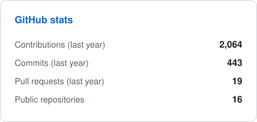
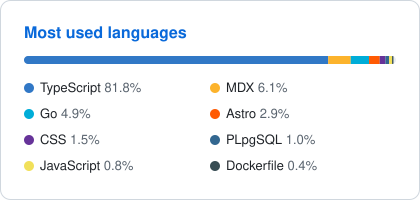

# Hi there, I'm Monirul Islam 👋

I build products end to end, from the UI down to the servers they run on. Based in Dhaka, Bangladesh.

---

### 👨‍💻 About me

- 🔭 Currently working on **personal projects and server infrastructure**
- 🌱 Learning **Kubernetes, system design and architecture**
- 👯 Looking to collaborate on **open source**
- 💬 Ask me about **Node.js, on-premise servers, Terraform, Kubernetes, AdTech and scaling**
- 📫 Reach me at **imonirul017@gmail.com**

---

### 🚀 Featured projects

<table>
  <tr>
    <td width="50%" valign="top">
      <h4>🍷 <a href="https://sangria.chat">Sangria</a></h4>
      A self-hostable team chat app: channels, threads, DMs, huddles, push notifications, desktop and mobile apps.
        
      <code>Next.js</code> <code>React</code> <code>Convex</code> <code>LiveKit</code> <code>Electron</code>
       
      <a href="https://sangria.chat">Website</a> · <a href="https://docs.sangria.chat">Docs</a>
    </td>
    <td width="50%" valign="top">
      <h4>📈 <a href="https://github.com/imonirulislam/pg_durable_dashboard">pg_durable_dashboard</a></h4>
      Web dashboard for the pg_durable Postgres extension: workflow runs, live execution graphs and metrics, read straight from SQL.
        
      <code>TypeScript</code> <code>PostgreSQL</code>
    </td>
  </tr>
  <tr>
    <td width="50%" valign="top">
      <h4>📐 <a href="https://github.com/imonirulislam/plumbline">plumbline</a></h4>
      Audits repositories against a configurable policy across GitHub, Gitea and GitLab. Read-only, with pluggable connectors.
        
      <code>Go</code>
    </td>
    <td width="50%" valign="top">
      <h4>🖥️ <a href="https://imonirulislam.dev">imonirulislam.dev</a></h4>
      My portfolio, built with a server console / system HUD look.
        
      <code>Next.js</code> <code>Tailwind CSS</code> <code>Framer Motion</code>
    </td>
  </tr>
</table>

---

### 🛠️ Tech stack

 

 

---

### 📊 GitHub activity

<picture>
  <source media="(prefers-color-scheme: dark)" srcset="https://raw.githubusercontent.com/imonirulislam/imonirulislam/output/stats-dark.svg" />
  
</picture>
<picture>
  <source media="(prefers-color-scheme: dark)" srcset="https://raw.githubusercontent.com/imonirulislam/imonirulislam/output/languages-dark.svg" />
  
</picture>

<picture>
  <source media="(prefers-color-scheme: dark)" srcset="https://raw.githubusercontent.com/imonirulislam/imonirulislam/output/snake-dark.svg" />
  
</picture>

